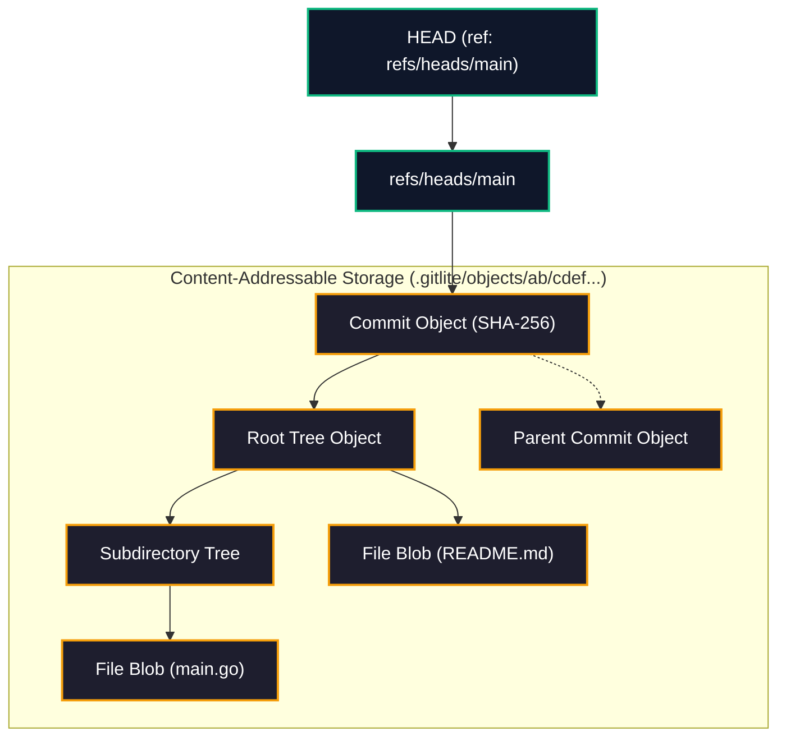
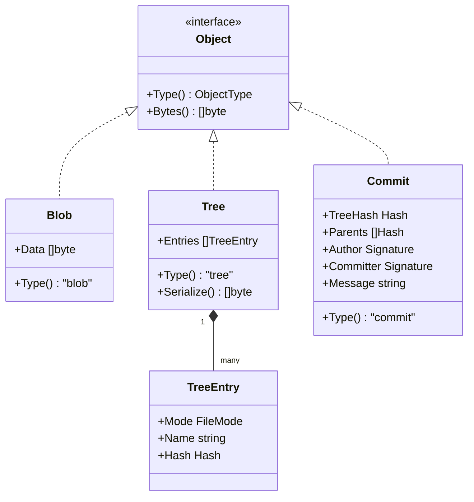
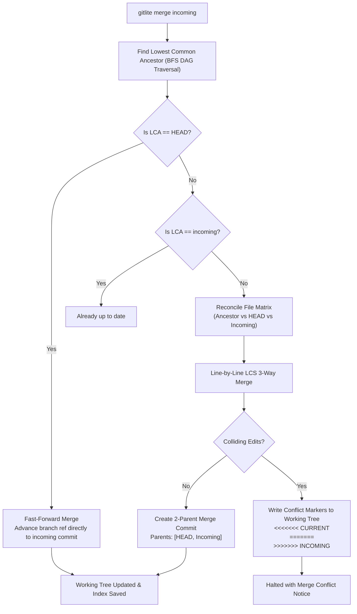

# GitLite — Distributed Version Control System from Scratch in Go

[](https://goreportcard.com/report/github.com/GhanshyamJha05/GitLite)
[](LICENSE)

GitLite is an independent, production-grade distributed version control system engineered entirely from scratch in Go (without external Git dependencies or wrappers). It implements the core algorithmic principles and systems primitives that underpin modern source code management:

- **Content-Addressable Storage (CAS):** Cryptographically identified, immutable, zlib-compressed object store.
- **DAG Object Model:** Blobs, nested trees with binary digest packing, and multi-parent commits forming a directed acyclic graph.
- **Atomic Staging Area (Index):** POSIX-ordered staging index with crash-safe atomic rename commits.
- **Branch Management & Safe Checkout:** Lightweight reference pointers and safety-guarded working tree switching.
- **Line Differential Engine:** Custom Longest Common Subsequence (LCS) unified diff generator.
- **Three-Way Merge Engine:** Lowest Common Ancestor (LCA) DAG traversal, fast-forward branch promotion, and automatic 3-way conflict marker synthesis.
- **Data Integrity Audit (`fsck`):** Cryptographic verification of all stored objects, graph reachability tracing, and dangling object detection.

---

## Architecture Overview

### 1. Storage & Object Database Layout

GitLite stores all repository metadata and objects inside the `.gitlite` hidden directory. All object writes are atomic (written to temporary files and renamed) and content-addressed via SHA-256.

```text
.gitlite/
├── objects/               # Content-addressed immutable objects
│   └── 4a/
│       └── b8c1...        # zlib-compressed envelope: <type> <size>\0<content>
├── refs/
│   └── heads/             # Branch references (e.g., main, feature)
├── HEAD                   # Symbolic reference (e.g., "ref: refs/heads/main") or detached commit hash
├── config                 # Repository configuration
└── index                  # Staging area tracking path, mode, size, mtime, and blob hash
```



---

### 2. Directed Acyclic Graph (DAG) Object Hierarchy

Every stored entity in GitLite inherits the canonical object envelope:
$$\text{Envelope} = \langle\text{type}\rangle \;\; \langle\text{size}\rangle \backslash 0 \;\; \langle\text{content}\rangle$$

$$\text{Object Hash} = \text{SHA-256}(\text{Envelope})$$

- **Blob:** Wraps arbitrary byte payloads representing file content (pure content-addressable; does not store filenames).
- **Tree:** Represents a directory snapshot. Entries contain file mode, filename, and a packed 32-byte binary SHA-256 digest, sorted deterministically using POSIX byte order.
- **Commit:** Points to a root tree, zero or more parent commits, author/committer identities, Unix timestamps, and commit message.



---

### 3. Three-Way Merge Workflow

When executing `gitlite merge <branch>`, GitLite carries out graph ancestry resolution and file-level reconciliation:



---

## Command Reference

| Command | Usage | Description |
| :--- | :--- | :--- |
| `init` | `gitlite init [directory]` | Initializes a fresh GitLite repository with `.gitlite` layout and default branch reference (`main`). |
| `add` | `gitlite add <path>...` | Stages files or directories recursively into the index, writing new blobs to CAS. Guarded against path traversal and `.gitlite` directory staging. |
| `status` | `gitlite status` | Compares working directory against staged index and HEAD commit, identifying untracked, modified, and staged changes. |
| `commit` | `gitlite commit -m "<message>"` | Builds hierarchical tree objects from staged index, synthesizes a commit pointing to HEAD parent, updates branch ref, and clears stage. |
| `log` | `gitlite log` | Walks the commit DAG backward from HEAD, printing author, timestamp, commit hashes, and commit messages. |
| `show` | `gitlite show [commit]` | Displays commit metadata, parent pointers, root tree hash, and commit message for a given hash or HEAD. |
| `branch` | `gitlite branch [-d <name>] [name]` | Lists local branches with active branch indicator, creates a new branch pointer at HEAD, or deletes an existing branch. |
| `checkout` | `gitlite checkout <branch-or-commit>` | Safely switches branches or detaches HEAD, restoring working directory while guarding uncommitted changes from corruption. |
| `switch` | `gitlite switch <branch>` | User-friendly shorthand dedicated to switching active branch references. |
| `diff` | `gitlite diff [--staged] [commit-a] [commit-b]` | Emits unified diff (`--- a/ +++ b/ @@ -l,s +l,s @@`) comparing working tree to index, staged changes to HEAD, or two arbitrary commits. |
| `merge` | `gitlite merge <branch>` | Performs lowest-common-ancestor 3-way merge, handling fast-forwards, non-conflicting edits, and conflict marker emission. |
| `fsck` | `gitlite fsck` | Audits the entire object database: checks zlib decompression, verifies cryptographic SHA-256 hashes, traces graph connectivity, and flags dangling objects. |

---

## Performance Benchmarks

Benchmarks executed on AMD Ryzen 7 7445HS (Windows 11 x86_64, Go 1.27):

```text
goos: windows
goarch: amd64
pkg: gitlite/tests
cpu: AMD Ryzen 7 7445HS w/ Radeon 740M Graphics

BenchmarkObjectStoreWrite-12              61134         22,319 ns/op        914 B/op       10 allocs/op
BenchmarkObjectStoreRead-12               13196         96,660 ns/op      46,256 B/op       19 allocs/op
BenchmarkLCSDiff-12                      476899          2,799 ns/op       2,440 B/op       19 allocs/op
BenchmarkHierarchicalTreeGeneration-12     2427        526,978 ns/op      98,306 B/op      864 allocs/op
BenchmarkRepositoryStatus-12               3680        301,918 ns/op      56,425 B/op      265 allocs/op
```

### Performance Highlights
- **Microsecond Object Ingestion:** Raw blob hashing, zlib compression, and atomic disk persistence complete in $\sim 22\,\mu\text{s}$ per object.
- **Fast Line Differential Calculation:** LCS diff computation operates at $\sim 2.8\,\mu\text{s}$ per pair of text buffers.
- **Sub-Millisecond Hierarchical Tree Generation:** Building deep nested tree hierarchies from large staged file indexes executes in $\sim 527\,\mu\text{s}$.
- **Fast Status Change Detection:** Full working tree traversal, metadata comparison, and status generation executes in $\sim 302\,\mu\text{s}$.

---

## Verification & Testing

The GitLite test suite incorporates comprehensive unit tests, concurrent data-race verification, and end-to-end integration workflows.

### 1. Run Complete Test Suite
```bash
go test -v ./...
```

### 2. Verify with Go Data-Race Detector
```bash
go test -race ./...
```

### 3. Run Static Analysis
```bash
go vet ./...
```

### 4. Execute Performance Benchmarks
```bash
go test -bench=. -benchmem ./tests/...
```

---

## Build from Source

```bash
# Clone the repository
git clone https://github.com/GhanshyamJha05/GitLite.git
cd GitLite

# Build binary
go build -o bin/gitlite ./cmd/gitlite

# Verify installation
./bin/gitlite --help
```

---

## License

This project is licensed under the [MIT License](LICENSE).
